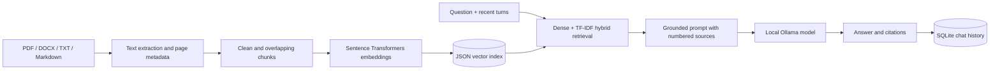

# Atlas — Local AI Knowledge Assistant

Atlas is a private, locally hosted document question-answering workspace. It extracts PDF, DOCX, TXT and Markdown text; creates overlapping chunks; embeds them with Sentence Transformers; blends dense semantic similarity with TF-IDF keyword relevance; and sends retrieved evidence to a local Ollama model for cited answers.

## Features

- Document upload, listing, deletion and re-indexing through a responsive dark web UI.
- PDF page-aware source metadata, overlap chunking, normalized `all-MiniLM-L6-v2` embeddings, hybrid search and source relevance scores.
- Grounded prompts with abstention guidance, recent conversation turns for follow-up references, and persistent SQLite chat history.
- Local JSON API plus terminal chat (`python main.py`).

## Architecture



## Technology and data layout

Python 3.10+, stdlib `http.server`, Sentence Transformers (`all-MiniLM-L6-v2`), NumPy, local NumPy cosine and TF-IDF ranking, pypdf, python-docx, requests, Ollama, SQLite.

```text
main.py                 Terminal chat
server.py               Local web server and JSON API
web/index.html           Responsive frontend
src/build_index.py       Extraction and indexing
src/chunking.py          Normalization and overlap chunking
src/embeddings.py        Embedding model configuration
src/retrieve.py          Dense + keyword hybrid retrieval
src/rag.py, src/llm.py   Context assembly and Ollama generation
src/vector_store.py      Atomic JSON index persistence
data/documents/          Local source documents
data/vector_store.json   Rebuildable index (ignored by Git)
data/app.sqlite3         Conversation history (ignored by Git)
tests/test_core.py       Offline core tests
```

## Installation and launch

Install Python 3.10+ and [Ollama](https://ollama.com/), then from the project root:

```powershell
py -m venv .venv
.\.venv\Scripts\Activate.ps1
python -m pip install --upgrade pip
pip install -r requirements.txt
Copy-Item .env.example .env
ollama pull llama3.2:3b
python server.py
```

Open <http://127.0.0.1:8000>. On macOS/Linux activate with `source .venv/bin/activate`. Sentence Transformers downloads the embedding model on first use. `.env.example` documents variables; the app reads process environment directly and does not auto-load `.env`.

Index existing files in `data/documents` with `python -m src.build_index`. Run terminal chat using `python main.py`.

## API

The server binds to loopback (`127.0.0.1:8000`) for local single-user use. `GET /api/openapi.json` provides a compact API description.

| Method | Endpoint | Description |
|---|---|---|
| GET | `/api/status` | Health and document/chunk counts |
| GET | `/api/documents` | List supported document files |
| POST | `/api/upload` | JSON `{ "name":"notes.txt", "content":"<base64>" }`; 15 MiB max |
| POST | `/api/chat` | JSON `{ "question":"..." }`; answer and sources response |
| GET / DELETE | `/api/history` | Read or clear conversation history |
| DELETE | `/api/documents/{name}` | Remove document and rebuild index |

```powershell
Invoke-RestMethod http://127.0.0.1:8000/api/status
Invoke-RestMethod http://127.0.0.1:8000/api/chat -Method Post -ContentType 'application/json' -Body '{"question":"Summarize the main points"}'
```

## RAG details

`create_chunks(text, chunk_size=900, overlap=120)` normalizes whitespace and prefers sentence boundaries. The index stores vectors, text and source metadata. Retrieval blends 75% cosine similarity and 25% TF-IDF unigram/bigram relevance. This is a ranking heuristic, not a calibrated probability. Context includes document name and PDF page. The model is instructed to use only evidence, treat document text as untrusted instructions, cite numbered sources, and abstain when evidence is insufficient.

Re-index after changing embedding models or chunk settings. `build_index(directory, output, chunk_size, overlap)` supports configurable indexing. JSON storage and per-query TF-IDF recomputation suit small collections, not large concurrent deployments.

## Tests

```powershell
python -m unittest discover -s tests -v
```

Tests cover chunk overlap/configuration, index persistence, and hybrid retrieval metadata. End-to-end generation needs Ollama and a downloaded embedding model. No faithfulness or Recall@K/Precision@K/MRR benchmark is claimed; an evaluation dataset is future work.

## Security, limits, troubleshooting

- Single-user local prototype: no authentication, authorization, rate limiting, multi-tenant bases, background jobs, or streaming.
- Upload extension/size checks (15 MiB) and PDF/DOCX signatures; no malware scan. Do not expose publicly without auth, CSRF defenses, TLS, deployment hardening and resource controls.
- Scanned PDFs need OCR, not implemented. Indexing is synchronous; dense JSON search and TF-IDF are intended for modest corpora.
- Ollama unavailable: start Ollama, check `OLLAMA_URL`, and pull the configured model (`ollama pull llama3.2:3b`). Embedding download failure: ensure registry access or configure a local model.
- No relevant sources: add documents, inspect `/api/status`, and re-index direct filesystem changes with `python -m src.build_index`.

There is no Docker deployment profile. A hosted deployment needs authentication, TLS/reverse proxy, durable storage, background indexing, monitoring and secrets management. OCR, reranking, evaluation sets, multi-user workspaces and streaming are future work.
